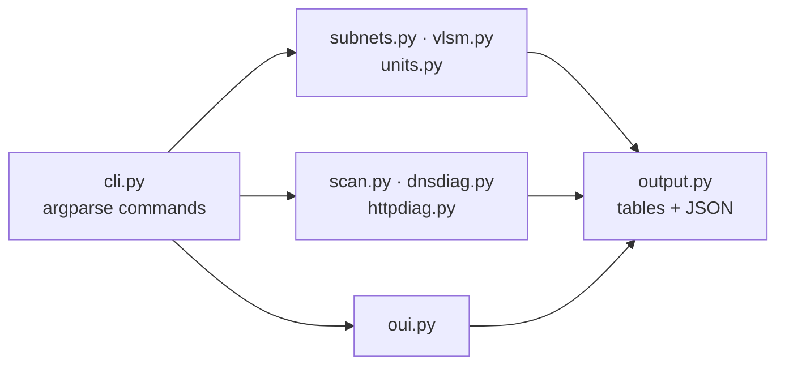

# netops-toolkit

[](https://github.com/jeremydacosta-TechOptimist/netops-toolkit/actions/workflows/ci.yml)
[](https://www.python.org/)
[](LICENSE)

A zero-dependency Python CLI toolbox for network engineers: subnet and VLSM planning, TCP scanning, reachability probes, DNS/HTTP/TLS diagnostics, MAC vendor lookup and bandwidth calculators.

Routine network checks usually mean stitching together a web subnet calculator, a scanner, `dig`, `curl -v` and a spreadsheet. `netops` puts those checks behind one typed Python package and one `argparse` CLI: the same logic runs from a shell, from `--json` pipelines and from Python code, with no runtime dependencies beyond the standard library.

## Features

- IPv4/IPv6 subnet math with strict CIDR validation, network/broadcast/host ranges, usable-host counts, /31 and /32 edge cases, prefix splitting, summarisation and overlap detection.
- VLSM planner that sorts VLAN host requirements, allocates contiguous non-overlapping subnets, reports free blocks and capacity.
- Multithreaded TCP connect scanner with timeouts, service-name hints and open/closed/filtered states.
- TCP reachability probe with per-target latency, retries and a shell-friendly exit code.
- DNS diagnostics through a small standard-library wire client: A, AAAA, MX, TXT, NS, PTR, CNAME, plus per-query timing.
- HTTP/TLS diagnostics: status, headers, redirect chain, certificate subject/issuer/validity days/SANs.
- Offline MAC OUI vendor lookup (150+ curated prefixes) and decimal/binary data-size and throughput calculators.

## Quick start

Requires Python 3.10+ and nothing else.

```bash
git clone https://github.com/jeremydacosta-TechOptimist/netops-toolkit.git
cd netops-toolkit
pip install -e .
netops --version
```

```text
netops 1.0.0
```

From a repository checkout you can also run `python -m netops` with `PYTHONPATH=src`.

## Usage

Exit codes: `0` success, `2` bad usage, `1` runtime failure or a negative diagnostic result (overlaps found, target unreachable, HTTP status >= 400, failed DNS query). Every command has `--help`, and the JSON-producing commands add `--json`.

### Subnet inspection and VLSM planning

```console
$ netops subnet 192.0.2.10/26
Input         : 192.0.2.10/26 (host bits normalised)
Network       : 192.0.2.0/26
Version       : IPv4 (/26)
Network addr  : 192.0.2.0
Broadcast     : 192.0.2.63
Netmask       : 255.255.255.192
Wildcard      : 0.0.0.63
Host range    : 192.0.2.1 - 192.0.2.62
Addresses     : 64
Usable hosts  : 62
Flags         : private
```

```console
$ netops vlsm 192.0.2.0/24 VLAN10=50 VLAN20=20 VLAN30=2
Parent : 192.0.2.0/24 (256 addresses)

VLAN    Requested  Prefix  Network        Usable  Host range               Util
------  ---------  ------  -------------  ------  -----------------------  ------
VLAN10  50         /26     192.0.2.0/26   62      192.0.2.1 - 192.0.2.62   80.6%
VLAN20  20         /27     192.0.2.64/27  30      192.0.2.65 - 192.0.2.94  66.7%
VLAN30  2          /31     192.0.2.96/31  2       192.0.2.96 - 192.0.2.97  100.0%

Free space   : 158 addresses
Free blocks  : 192.0.2.98/31, 192.0.2.100/30, 192.0.2.104/29, 192.0.2.112/28, 192.0.2.128/25
Capacity     : 98/256 addresses (38.3%)
```

### TCP scan and reachability

With a local service running on `127.0.0.1:8080` (`python -m http.server 8080 --bind 127.0.0.1`):

```console
$ netops scan 127.0.0.1 -p 22,80,443,8080
Target  : 127.0.0.1 (127.0.0.1)
Ports   : 4 | workers: 4 | timeout: 0.75s

Port      State     Service   Latency
--------  --------  --------  -------
22/tcp    filtered  ssh       -
80/tcp    filtered  http      -
443/tcp   filtered  https     -
8080/tcp  open      http-alt  0.28 ms

4 scanned: 1 open, 0 closed, 3 filtered, 0 error in 0.76s
```

```console
$ netops reach 127.0.0.1 -p 8080
Target     Address    State  Port  Latency  Detail
---------  ---------  -----  ----  -------  -------------
127.0.0.1  127.0.0.1  open   8080  0.89 ms  tcp/8080 open

1 reachable, 0 unreachable (ports: 8080, timeout: 1.00s)
```

### DNS and HTTP/TLS diagnostics

```console
$ netops dns example.com --type A
DNS diagnostics for example.com
Server: 192.168.1.254:53 (system resolver)

A example.com  NOERROR  2 answers  1.38 ms
  172.66.147.243  ttl 26
  104.20.23.154  ttl 26

Summary: 1 query, 1 NOERROR, 0 failed, total 1.53 ms
```

```console
$ netops http https://example.com
GET https://example.com
Final URL : https://example.com
Status    : 200 OK
Remote    : [2606:4700:10::ac42:93f3]:443
Elapsed   : 195.63 ms

Redirects: none

TLS
  Protocol    : TLSv1.3
  Cipher      : TLS_AES_256_GCM_SHA384 (256 bits)
  Verified    : yes
  Subject     : example.com
  Issuer      : Cloudflare TLS Issuing ECC CA 3
  Valid from  : 2026-09-26 22:49:11 UTC
  Valid until : 2026-12-25 22:56:35 UTC
  Days left   : 39
  SANs        : DNS:example.com, DNS:*.example.com

Headers (12):
  Date: Mon, 16 Nov 2026 17:09:20 GMT
  Content-Type: text/html; charset=utf-8
  Transfer-Encoding: chunked
  Connection: close
  Server: cloudflare
  last-modified: Mon, 16 Nov 2026 00:30:20 GMT
  allow: GET, HEAD
  Accept-Ranges: bytes
  Age: 4
  cf-cache-status: HIT
  CF-RAY: a5b81a553b1d6666-MRS
  alt-svc: h3=":443"; ma=86400

Body: 577 bytes read
```

### MAC vendor lookup and bandwidth math

```console
$ netops mac 00:00:0c:12:34:56
MAC        : 00:00:0C:12:34:56
OUI        : 00000C
Vendor     : Cisco Systems, Inc.
Scope      : unicast, globally administered
```

```console
$ netops bandwidth --size 10GB --rate 100Mbps
Data size: 10GB
  Bytes   : 10,000,000,000
  Decimal : 10.00 GB
  Binary  : 9.31 GiB

Link rate: 100Mbps
  Bits/s  : 100,000,000 bit/s
  Bytes/s : 12,500,000 B/s (12.50 MB/s, 11.92 MiB/s)

Transfer time: 800.00 s (13 min 20 s)
```

## Architecture



`cli.py` builds one `argparse` tree and dispatches to a small handler per subcommand. Handlers call module functions that return plain dictionaries, which keeps text rendering, `--json` output and unit tests on the same code path. Network modules (`scan.py`, `dnsdiag.py`, `httpdiag.py`) do their own socket work and convert expected failures into `NetopsError`, which the CLI prints as a one-line error and exit code 1. `subnets.py` is the shared foundation: `vlsm.py` reuses its host-range and capacity rules, and `output.py` formats the results. No module imports a third-party package.

## Project layout

```
netops-toolkit/
├── .github/workflows/ci.yml
├── .gitignore
├── LICENSE
├── README.md
├── pyproject.toml
├── src/netops/
│   ├── __init__.py        # version
│   ├── __main__.py        # python -m netops
│   ├── cli.py             # argparse commands and text output
│   ├── subnets.py         # CIDR reports, split, summarise, overlaps
│   ├── vlsm.py            # VLSM planner
│   ├── scan.py            # TCP scanner and reachability
│   ├── dnsdiag.py         # DNS wire client and timing
│   ├── httpdiag.py        # HTTP/TLS diagnostics
│   ├── oui.py             # MAC parsing and vendor table
│   ├── units.py           # data-size and bandwidth calculators
│   ├── output.py          # table and JSON helpers
│   └── errors.py          # NetopsError and exit codes
└── tests/
    ├── helpers.py         # local sockets, fake DNS and HTTP servers
    └── test_*.py          # 8 test modules for the modules and the CLI
```

## Testing

The suite has 152 `unittest.TestCase` tests (215 subtests under pytest) and runs fully offline: localhost sockets, a fake DNS server and a local HTTP server only, no internet access.

```powershell
# from the repository root
$env:PYTHONPATH = "src"
py -3.13 -m pytest -q
python -m unittest discover -s tests -v
```

The current run reports `152 passed, 215 subtests passed` with pytest and `Ran 152 tests ... OK` with unittest. Coverage includes subnet edge cases (/31, /32, IPv6 prefixes, host-bit handling), VLSM alignment and capacity accounting, port and reachability classification, DNS packet encoding/decoding with compression and error rcodes, HTTP redirects and certificate parsing, MAC formats and OUI accuracy, unit conversions, and the CLI contract (help, JSON, exit codes). CI runs the suite on Python 3.10, 3.11, 3.12 and 3.13.

## Roadmap

- Add UDP scanning and optional TCP banner grabbing to the scanner.
- Extend the VLSM planner to IPv6 prefixes.
- Support batch input files (one CIDR or VLAN requirement per line) for scheduled reports.

## Resumo em português (PT-PT)

- Ferramenta de linha de comandos em Python, sem dependências externas, que reúne as verificações de rede mais frequentes num único utilitário.
- Calcula sub-redes IPv4 e IPv6, planeia VLSM para VLANs, agrega redes e deteta sobreposições.
- Verifica portas TCP, alcançabilidade, DNS e HTTP/TLS, incluindo a validade dos certificados.
- Identifica o fabricante de endereços MAC com uma tabela OUI integrada e converte unidades de dados e débito.
- Inclui uma suite de testes offline e corre em Python 3.10 ou superior.

## License

MIT © 2026 Jeremy da Costa. See [LICENSE](LICENSE).
